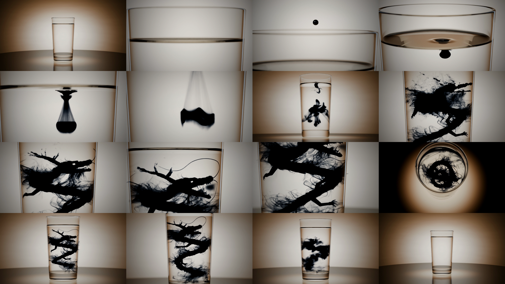

# Ink Dragon — 45 s Blender film

A drop of black ink falls into a glass of water; the plume coils into an East Asian dragon, lives for
three seconds of simulated time (shown in slow motion from many angles) and dissolves.

- Final video: [`media/ink_dragon_1080p30.mp4`](media/ink_dragon_1080p30.mp4) (1920x1080, 30 fps, 45 s, H.264 + AAC).
  The pipeline writes the full-quality master to `out/ink_dragon_1080p30.mp4`.
- Not in this repository: rendered frames, VDB volumes and simulation caches (regenerated by the scripts) and the
  downloaded music/SFX files (sources and licenses in `audio/CREDITS.md`; put them into `audio/music/` and
  `audio/sfx/` before running `scripts/mix_audio.py`).
- Rendered with Blender 5.2.3 / Cycles (CPU), ink as OpenVDB volumes generated by the scripts below.
- The last frame matches the first one (camera and clear water), so the film loops seamlessly.
- Close-up shots are rendered at 1600x900 and upscaled to 1080p in the edit; wide shots are native 1080p.
- 993 of the 1350 frames are rendered in Cycles: every second frame of every shot, plus every frame of the
  opening, the drop, the morph, the roar close-up and the hero wide shot (and most of the body glide). The other
  357 in-between frames (impact, plume, top-down, late dissolve, final shot) are motion-compensated
  interpolations of their two rendered neighbours (`scripts/fill_missing.py`), with their fine detail matched to
  those neighbours (`scripts/match_fill.py`). `scripts/assemble.py` prints the counts. To replace them with real
  renders, run `render_film.py -- planB --wait` (after baking the missing VDBs) and assemble again.

## How it is built

| Step | Script | What it does |
|---|---|---|
| Ink simulation | `scripts/run_film.py plume`, `dissolve` | Lagrangian ink *sheets* advected through a vortex-ring flow (plume) and a decaying turbulent field (dissolve) |
| Dragon | `scripts/ink/dragon.py` | Procedural dragon: animated spine, SDF head/antlers/teeth/claws, ~1200 wisp sheets (mane, flame tufts, tail brush, whiskers) |
| Volumes | `scripts/run_film.py bake` | Rasterises sheets + solids into one VDB per frame (`work/vdb/`) |
| Set | `scripts/scene_lib.py`, `scripts/surface_model.py` | Glass, water (crater, jet, ripples from a closed-form surface model), lantern backdrop, table |
| Shots | `scripts/shots.py` | Timeline (speed ramps), 14 camera set-ups, per-shot voxel size / sample count |
| Render | `scripts/render_film.py` | One PNG per frame into `frames/` |
| Sound | `scripts/mix_audio.py` | Mixes the downloaded music + SFX (no synthesized audio) |
| In-betweens | `scripts/fill_missing.py`, `scripts/match_fill.py` | Interpolates frames that were not rendered and matches their fine detail to the rendered neighbours |
| Edit | `scripts/assemble.py` | Segments -> grade, grain (no fades: the film loops) -> MP4 with audio |

Shared constants are in `scripts/common.py`.

## Audio credits (required attribution)

All audio was downloaded from free sources (CC0 / CC BY); full list with links in `audio/CREDITS.md`.

- Music: "Cinematic Suspense Trailer - Extended Percussion Version" by Gregor Quendel (gregorquendel.com), CC BY 4.0, via OpenGameArt.org
- Sound effects from Freesound.org, CC BY 4.0: "Movie Trailer Boom" by hykenfreak; "Water Swirl, Small, 8" and
  "Splash, Small, A" by InspectorJ; "Water Drop Single" by EminYILDIRIM
- Additional CC0 sounds from Freesound.org (no credit required, listed for courtesy): florianreichelt,
  14FPanska_Nemec_Petr, InMotionAudio, Rimmer, Fission9, ristooooo1, Qvantor, godspine, rhapsodize, swiftoid,
  ThomEvans, cylon8472, sonically_sound, ryancacophony, janbezouska
- CC BY 4.0: https://creativecommons.org/licenses/by/4.0/

If you publish the video, put these credits in the description.

## License

Code: MIT (see `LICENSE`). The music and sound effects in the video keep their own licenses (CC BY 4.0 / CC0, see above and `audio/CREDITS.md`).
